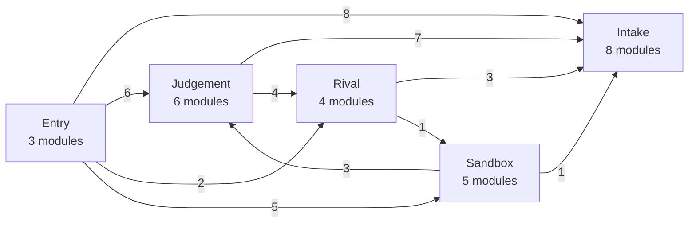
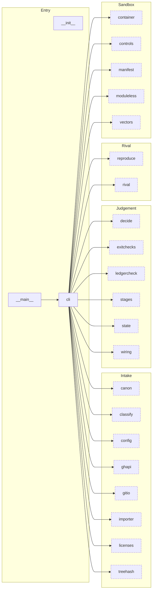
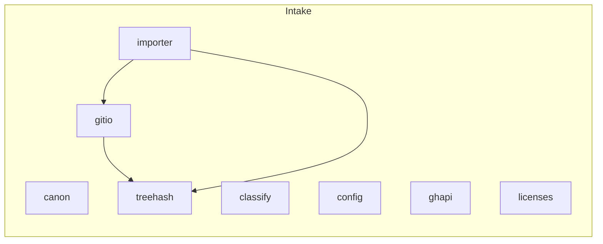
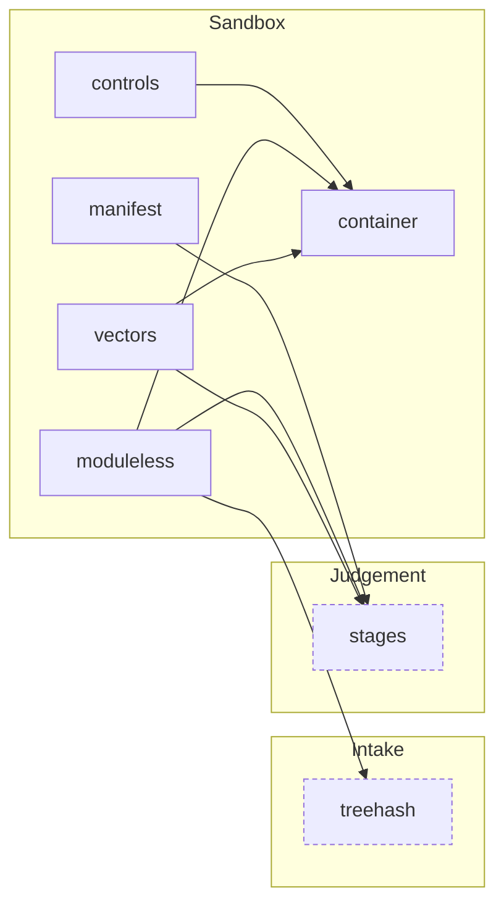
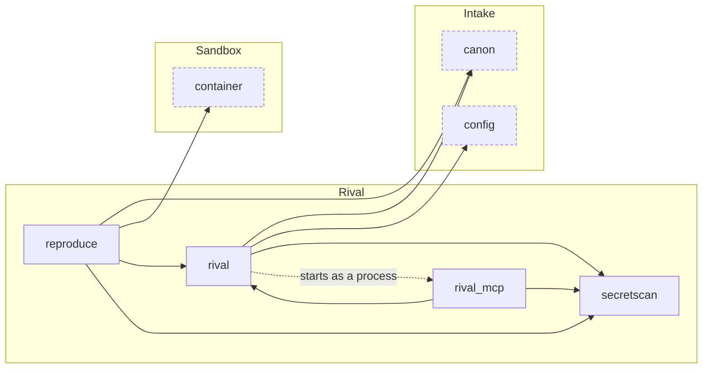
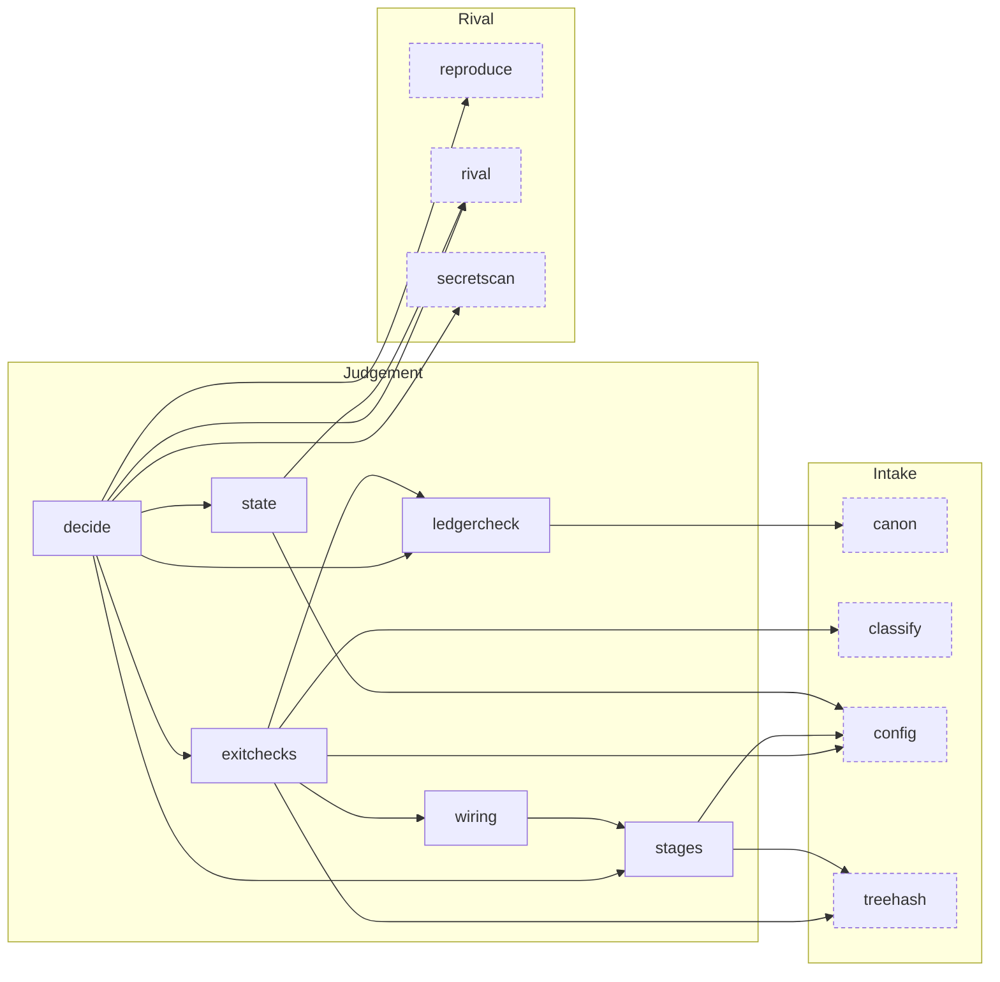
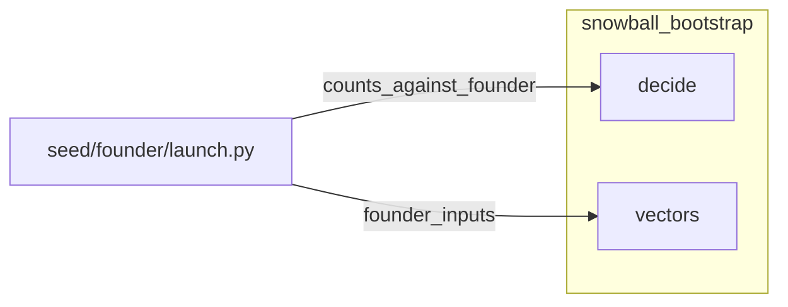

# System map

Generated by `seed/bootstrap/local/system_map.py` — do not edit by hand; regenerate with `python3 local/system_map.py` from `seed/bootstrap`. `tests/test_wiring.py` (`SystemMapTest`) fails when this page no longer matches the code (owner rule E301, `docs/eksik-kaydi.md`).

Read from the code: the jobs, `needs:` and commands of `seed/bootstrap/workflow/bootstrap.yml`; the imports of every module of `seed/bootstrap/snowball_bootstrap/` (with `ast`); the subcommands of `cli.py`; the imports of `seed/founder/launch.py`. Written by hand, in one block at the top of the script: the four actors outside the code, the links that meet them (each must still be found in the file it names, or the map is not drawn) and the area each module belongs to.

## Legend

| Mark | Meaning |
|---|---|
| Rectangle | Code in this repository: a file, a workflow job or a module |
| Rounded, cylinder, hexagon | Outside the code: the operator; a repository or log; the rival model |
| Solid arrow | Diagram 1: the job runs after the other (`needs:`). Diagrams 2-3: imports |
| Dotted arrow, labelled | Something crosses a boundary: a push, a dispatch, an artifact, a call, a process |
| Dashed border | A module of another area, drawn where this area imports it |

## 1. System flow

13 nodes, 19 edges. A job box lists the `snowball_bootstrap` commands it runs, in order. Job arrows leave out dependencies another path already implies; the table lists every `needs:`. A seed epoch is the operator's delivery of `spec/tohum/` and `seed/` to the brain, with the `seed_epochs` row the referee checks on its next pull (`seed/founder/README.md`).

```mermaid
flowchart LR
  operator(["Operator"])
  brain[("Brain repository (GitHub)")]
  rival{{"Rival model (Claude, operator's login)"}}
  rekor[("Rekor (Sigstore transparency log)")]
  subgraph machine["Operator's machine"]
    launcher["launcher<br/>seed/founder/launch.py"]
    capsule["Founder capsule, Docker<br/>Dockerfile · entrypoint.sh · prompt.md"]
    scorecard["scorecard<br/>seed/founder/scorecard.py"]
  end
  subgraph referee["Referee repository: workflow/bootstrap.yml on GitHub Actions"]
    job_cek["job cek<br/>control · config-value · poll · licenses · fetch-state · pull · pack"]
    job_getir["job getir<br/>control · fetch-deps · pack"]
    job_kos["job kos<br/>control · run-tests · pack"]
    job_cagir["job cagir<br/>control · rival · pack"]
    job_yeniden["job yeniden<br/>control · reproduce · pack"]
    job_yaz["job yaz<br/>control · decide · licenses"]
  end
  job_cek --> job_getir
  job_getir --> job_kos
  job_kos --> job_cagir
  job_cagir --> job_yeniden
  job_yeniden --> job_yaz
  operator -.->|starts the pilot| launcher
  launcher -.->|docker run: one Founder session| capsule
  capsule -.->|git push| brain
  launcher -.->|dispatch: gh workflow run| referee
  brain -.->|read anonymously| job_cek
  job_cagir -.->|claude CLI: claims and reproducers| rival
  job_yaz -.->|signs result.json, keyless| rekor
  job_yaz -.->|signed verdict: bootstrap-state artifact| launcher
  launcher -.->|last verdict, read-only: /work/referee| capsule
  operator -.->|seed epoch: delivers spec/tohum and seed/| brain
  operator -.->|installs bootstrap/, vectors/, kill switch, seed_epochs row| referee
  operator -.->|after each cycle: docs/karne.md| scorecard
  job_yaz -.->|signed results, digest-checked, cached| scorecard
  brain -.->|ledger, chain verified, and test manifests| scorecard
```

| Job | needs | Runs | Permissions | Secrets |
|---|---|---|---|---|
| `cek` | - | `control`, `config-value`, `poll`, `licenses`, `fetch-state`, `pull`, `pack` | contents: read, actions: read | - |
| `getir` | `cek` | `control`, `fetch-deps`, `pack` | {} | - |
| `kos` | `cek`, `getir` | `control`, `run-tests`, `pack` | {} | - |
| `cagir` | `cek`, `kos` | `control`, `rival`, `pack` | {} | `CLAUDE_CODE_OAUTH_TOKEN` |
| `yeniden` | `cek`, `getir`, `kos`, `cagir` | `control`, `reproduce`, `pack` | {} | - |
| `yaz` | `cek`, `getir`, `kos`, `cagir`, `yeniden` | `control`, `decide`, `licenses` | contents: read, id-token: write | - |

## 2. Referee package: `seed/bootstrap/snowball_bootstrap`

26 modules, 59 imports inside the package, 1 started as a separate process. Areas are roles. The overview has 5 areas and 10 edges; an arrow's number is how many imports cross from one area to the other.

### Entry

3 modules, 22 edges out of them.

| Module | What it is (first sentence of its docstring) | Imported by |
|---|---|---|
| `__init__` | Snowball bootstrap referee. | - |
| `__main__` | - | - |
| `cli` | Command-line entry points: one subcommand per workflow step (`workflow/bootstrap.yml`). | `__main__` |

### Intake

8 modules, 3 edges out of them.

| Module | What it is (first sentence of its docstring) | Imported by |
|---|---|---|
| `canon` | Canonical JSON (the RFC 8785 subset the seed allows) and hashing helpers. | `cli`, `ledgercheck`, `reproduce`, `rival` |
| `classify` | What kind of push is this (`tohum/29b`, "İki tür push")? | `cli`, `exitchecks` |
| `config` | Operator-written inputs, validated strictly. | `cli`, `exitchecks`, `rival`, `stages`, `state` |
| `ghapi` | Minimal GitHub REST calls the pull job needs: find and download the latest state artifact, and look at the newest failed run of this workflow (E13). | `cli` |
| `gitio` | Git operations on the untrusted brain repository. | `cli`, `importer` |
| `importer` | Operator import at the Stage 0 exit (`tohum/25a` 1-2). | `cli` |
| `licenses` | License gate for downloaded wheels (`tohum/24`, "Lisans"). | `cli` |
| `treehash` | Tree hashes over git-archive tarballs, and safe extraction of regular files only. | `cli`, `exitchecks`, `gitio`, `importer`, `moduleless`, `stages` |

### Sandbox

5 modules, 7 edges out of them.

| Module | What it is (first sentence of its docstring) | Imported by |
|---|---|---|
| `container` | Run untrusted code in a nested, network-less, unprivileged container (`tohum/08` 2). | `cli`, `controls`, `moduleless`, `reproduce`, `vectors` |
| `controls` | Red controls: known answers about the runner itself (`tohum/08` 3). | `cli` |
| `manifest` | The founder's test manifest (`snowball-tests.json`, `tohum/26c`) and its lock files. | `cli` |
| `moduleless` | Module-less red (`asama-0/14`; `tohum/04` 1, "Kasıtlı bozma"): a micro-feature's tests fail without it. | `cli` |
| `vectors` | Apply the seed vectors (`tohum/29a`, `29d`) to the founder's code through the fixed interface. | `cli` |

### Rival

4 modules, 10 edges out of them.

| Module | What it is (first sentence of its docstring) | Imported by |
|---|---|---|
| `reproduce` | Run reproducers in the same sandbox as the tests (`tohum/29`, "Rakibin kuralları"). | `cli`, `decide` |
| `rival` | The seed rival (`tohum/29`), run through the operator's own ``claude`` CLI. | `cli`, `decide`, `reproduce`, `rival_mcp`, `state` |
| `rival_mcp` | Stdio MCP server that gives the seed rival (`tohum/29`) its four tools. | - |
| `secretscan` | Secret patterns checked before any text leaves for the model provider (`tohum/08` 11). | `decide`, `reproduce`, `rival`, `rival_mcp` |

### Judgement

6 modules, 18 edges out of them.

| Module | What it is (first sentence of its docstring) | Imported by |
|---|---|---|
| `decide` | The acceptance decision (`tohum/29b`, "Kabul" and "Aşama 0 çıkışının (A) parçası"). | `cli` |
| `exitchecks` | The (A) conditions of `asama-0/10` that `pull` checks on the brain archive it already holds (`29b`; the draft `29e` "Tohum denetimleri": in `çek`, read from the archive, never ... | `cli`, `decide` |
| `ledgercheck` | The Founder's ledger (`asama-0/10` #kurucu-defteri, `asama-0/09` test 30, `tohum/26`, `00a`; E107, E280). | `cli`, `decide`, `exitchecks` |
| `stages` | The stage tables (`asama-0/14`, `tohum/26c` "Aşama tablosu"): the machine copy of a stage's micro-features. | `cli`, `decide`, `manifest`, `moduleless`, `vectors`, `wiring` |
| `state` | The bootstrap's memory between runs: the last signed result's ``state`` block. | `cli`, `decide` |
| `wiring` | The loop workflow's wiring rules (`asama-0/10` #is-akisi, `asama-0/09` test 46, `asama-0/14` MF17; `tohum/08`, `01a`; E100, E162, E281-E283). | `cli`, `exitchecks` |

### Commands

Every subcommand of `cli.py`, the jobs that run it, and the package modules its handler reaches through `cli.py`'s own helpers. A command no job runs is run by the operator or a local tool.

| Command | Run by | Handler | Modules it reaches |
|---|---|---|---|
| `control` | `cek`, `getir`, `kos`, `cagir`, `yeniden`, `yaz` | `cmd_control` | `config` |
| `config-value` | `cek` | `cmd_config_value` | `config` |
| `poll` | `cek` | `cmd_poll` | `config`, `decide`, `ghapi`, `gitio`, `treehash` |
| `licenses` | `cek`, `yaz` | `cmd_licenses` | `canon`, `config`, `licenses` |
| `fetch-state` | `cek` | `cmd_fetch_state` | `canon`, `config`, `decide`, `ghapi`, `importer`, `state` |
| `pull` | `cek` | `cmd_pull` | `canon`, `classify`, `config`, `exitchecks`, `gitio`, `ledgercheck`, `manifest`, `rival`, `stages`, `treehash`, `wiring` |
| `fetch-deps` | `getir` | `cmd_fetch_deps` | `canon`, `manifest`, `treehash` |
| `run-tests` | `kos` | `cmd_run_tests` | `canon`, `config`, `container`, `controls`, `licenses`, `moduleless`, `stages`, `treehash`, `vectors` |
| `rival` | `cagir` | `cmd_rival` | `canon`, `config`, `rival`, `treehash` |
| `reproduce` | `yeniden` | `cmd_reproduce` | `canon`, `config`, `container`, `reproduce`, `treehash`, `vectors` |
| `decide` | `yaz` | `cmd_decide` | `canon`, `config`, `decide` |
| `pack` | `cek`, `getir`, `kos`, `cagir`, `yeniden` | `cmd_pack` | - |
| `unpack` | operator / local | `cmd_unpack` | `treehash` |
| `seed-hash` | operator / local | `cmd_seed_hash` | `gitio`, `treehash` |
| `seed-epoch` | operator / local | `cmd_seed_epoch` | `canon`, `classify`, `gitio`, `treehash` |
| `import` | operator / local | `cmd_import` | `importer` |

## 3. Launcher links

`seed/founder/launch.py` runs on the operator's machine and imports 2 referee modules, so the launcher applies the referee's own rules instead of a copy (E244). Through them it loads 15: `canon`, `classify`, `config`, `container`, `decide`, `exitchecks`, `ledgercheck`, `reproduce`, `rival`, `secretscan`, `stages`, `state`, `treehash`, `vectors`, `wiring`.

